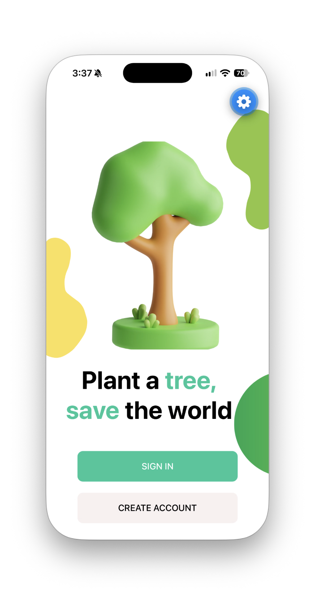
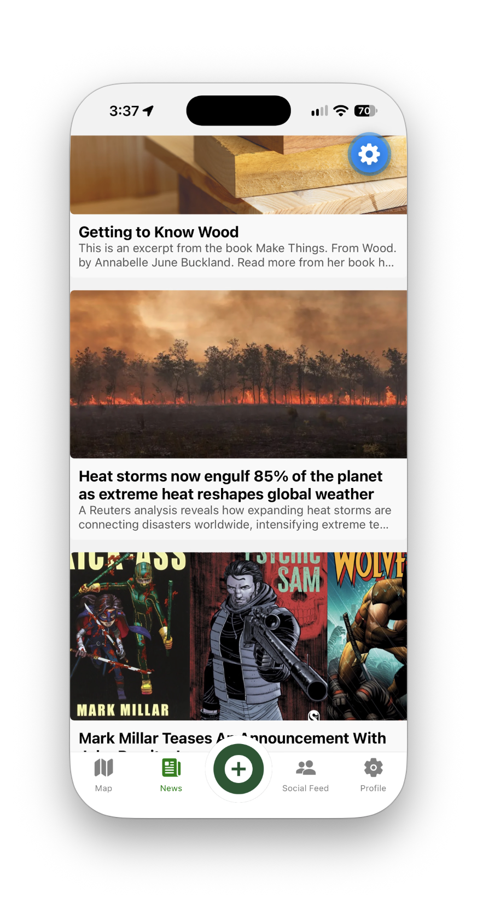

<div align="center">

# 🌱 EcoGuardian

### Plant a tree. Save the world.

**A mobile platform connecting deforestation awareness, environmental monitoring, community campaigns, and tree-planting action.**

Built with **React Native · Expo · Firebase · Google Maps · TensorFlow.js**

</div>

---

## Overview

**EcoGuardian** is a mobile environmental monitoring and community engagement application that helps people explore possible changes in tree coverage, discover environmental campaigns, and take part in reforestation.

On the map, users can explore monitored locations and compare **historical and current imagery**, including detected tree counts and vegetation visualisations supplied by an environmental-analysis backend. Beyond monitoring, the app helps users find nearby nurseries, visualise a planted tree, follow planting guidance, and keep a record of their contributions.

The app also includes a **community feed**, public/private location-based campaigns, user profiles, and environmental news.

> **Repository scope:** This repository contains the **React Native / Expo mobile application**. The original external environmental-analysis backend used to produce imagery, tree detections and NDVI reports is **not included**. Some monitoring and campaign-analysis workflows therefore require that separate service and suitable Firebase data.

## App preview

<table>
  <tr>
    <td align="center"><strong>Welcome</strong></td>
    <td align="center"><strong>Environmental map</strong></td>
    <td align="center"><strong>News</strong></td>
    <td align="center"><strong>Create campaign</strong></td>
  </tr>
  <tr>
    <td></td>
    <td></td>
    <td></td>
    <td></td>
  </tr>
</table>

*Screenshots are loaded directly from the repository's root `public/` directory.*

## Features

| Area | What users can do |
| --- | --- |
| **Authentication** | Register, verify email, sign in, recover passwords and manage profiles |
| **Interactive map** | View monitored locations, use device location and search places |
| **Tree-cover comparison** | View current/historical images, processed detections and tree counts |
| **Environmental reports** | Review NDVI imagery and generated explanations for possible tree loss |
| **Local action** | Get directions to affected locations and find nearby tree nurseries |
| **Community campaigns** | Create public/private location-based posts with a title, image and description |
| **Social feed** | Browse public campaigns, visit profiles and manage comments |
| **Planting assistance** | Preview tree placement in a photo and follow planting tutorials |
| **Planting verification** | Capture a photo and run a bundled on-device TensorFlow.js model |
| **My Forest** | Track planted-tree count and view an illustrative 3D forest and impact estimates |
| **Environmental news** | Browse tree-related articles via NewsAPI |

### How environmental monitoring works

1. The analysis service supplies historical and current images for a monitored location.
2. Processed images and detected-tree counts are made available to the app.
3. The mobile app compares the supplied counts: **fewer trees in the current image** indicates *possible* deforestation.
4. Users can inspect supporting imagery, NDVI visualisations and the generated location report.
5. The application connects the finding to practical actions, such as locating a nursery and following tree-planting instructions.

**Important:** A difference in detected tree counts is a screening signal, **not definitive proof of deforestation**. Image quality, seasonal conditions, imagery alignment and detection accuracy can affect the result. NDVI processing is performed outside this mobile frontend.

### Tree-planting journey

```text
Explore a location → Find a nursery → Preview tree placement
         → Follow planting guide → Photograph planted tree
         → Run on-device verification → Update My Forest
```

The app's planting verification uses a bundled **TensorFlow.js** model to process a resized `64 × 64` photograph and compare a reconstruction error with a configured threshold. This is different from the external service that analyses geographical imagery. Verification is model-assisted rather than independent proof that a tree was successfully planted.

## Tech stack

| Layer | Technologies |
| --- | --- |
| Mobile application | React Native, Expo, JavaScript (plus a TypeScript-based 3D component) |
| Navigation and UI | React Navigation, React Native Paper, vector icons, Lottie, React Native Copilot |
| Maps and location | React Native Maps, Google Maps SDKs, Google Places API, Expo Location |
| Accounts and data | Firebase Authentication, Firebase Realtime Database, Firebase Storage |
| Camera and media | Expo Image Picker, Expo Image Manipulator, Expo Video |
| On-device ML | TensorFlow.js, `tfjs-react-native` |
| 3D visualisation | Three.js, React Three Fiber, Drei |
| News and networking | NewsAPI, Axios, Fetch API |
| Forms | Formik, Yup |
| External analysis | Separate tree detection, imagery comparison and NDVI service **(not in this repository)** |

## Architecture

```text
                        ┌────────────────────────────────────┐
                        │     EcoGuardian mobile app         │
                        │         React Native / Expo        │
                        └─────────────────┬──────────────────┘
                                          │
            ┌─────────────────────────────┼──────────────────────────────┐
            │                             │                              │
            ▼                             ▼                              ▼
   ┌────────────────┐          ┌──────────────────────┐        ┌─────────────────────┐
   │ Firebase       │          │ Google Maps / Places │        │ NewsAPI             │
   │ Auth, Database │          │ Location / nurseries │        │ Environmental news  │
   │ and Storage    │          └──────────────────────┘        └─────────────────────┘
   └────────────────┘
            ▲
            │ monitored-location data and campaign records
            │
   ┌───────────────────────────────────────────────────────┐
   │ External environmental-analysis backend (not included)│
   │ Historical/current imagery · tree counts · NDVI       │
   │ Campaign location processing: POST /add               │
   └───────────────────────────────────────────────────────┘

   On device: TensorFlow.js planting-photo verification + 3D forest
```

## Getting started

### Prerequisites

- **Node.js** and **npm** (use a version compatible with this repository's Expo SDK).
- **Expo tooling**, normally through `npx expo`.
- An **Android emulator / device** or **iOS simulator / device**. iOS Simulator requires macOS and Xcode.
- A **Firebase project** with Authentication, Realtime Database and Storage configured.
- **Google Maps / Places API credentials** for features that require them.
- A **NewsAPI key** for the news feed.
- Access to the **separate environmental-analysis API** if testing backend-dependent workflows.

> React Native libraries involving native code, maps or TensorFlow may require an **Expo development build**, rather than Expo Go. Check the repository's Expo SDK and native configuration before choosing a runtime.

### 1. Clone and install

```bash
git clone https://github.com/<YOUR_USERNAME>/<YOUR_REPOSITORY>.git
cd <YOUR_REPOSITORY>
npm install
```

Replace the placeholder GitHub URL with your repository URL. If the project uses a different package manager, use its lockfile and installation command.

### 2. Configure Firebase

1. Create a project in the [Firebase Console](https://console.firebase.google.com/).
2. Enable **Authentication** and the sign-in methods used by the application (email/password is required for the described flow).
3. Configure **Realtime Database** and **Cloud Storage**.
4. Register the appropriate app and obtain its Firebase configuration.
5. Set appropriate **database and storage security rules** before using real user data. Do not use permissive test rules in production.
6. Configure any required platform identifiers, permissions and Google services files for the app's Expo/native setup.

### 3. Create your environment file

Use the example file that comes with the repository:

```bash
cp .env.example .env
```

Then fill in `.env` using the real Firebase, Maps, NewsAPI and backend values required by the source code.

**Configuration checklist**

| Configuration | Purpose |
| --- | --- |
| Firebase API key | Firebase client-app configuration |
| Firebase Auth domain / project ID | Firebase project identity, if required by the project setup |
| Firebase Realtime Database URL | Reads and writes app data |
| Firebase Storage bucket | Profile and campaign photos |
| Google Maps / Places key | Map features, location search and nearby nursery discovery |
| NewsAPI key | Loads tree-related news |
| External analysis API URL | Connects the mobile app to the separate `POST /add` service |

**Example template** *(illustrative names — match the exact environment-variable names used in your code and existing `.env.example`):*

```dotenv
# Firebase client configuration
EXPO_PUBLIC_FIREBASE_API_KEY=your_firebase_api_key
EXPO_PUBLIC_FIREBASE_AUTH_DOMAIN=your-project.firebaseapp.com
EXPO_PUBLIC_FIREBASE_PROJECT_ID=your-project-id
EXPO_PUBLIC_FIREBASE_DATABASE_URL=https://your-database-url
EXPO_PUBLIC_FIREBASE_STORAGE_BUCKET=your-project.firebasestorage.app

# External services
EXPO_PUBLIC_GOOGLE_MAPS_API_KEY=your_google_maps_api_key
EXPO_PUBLIC_NEWS_API_KEY=your_news_api_key
EXPO_PUBLIC_ANALYSIS_API_URL=https://your-backend.example.com
```

**Important:** The variable names above are **a suggested example, not verified names from this repository**. Expo makes `EXPO_PUBLIC_` values available in the client bundle, so **never put service-account JSON, private tokens or server-side secrets in them**. Configure Google API-key restrictions and keep confidential backend credentials on the server. Expo environment variables are read only where your application code actually references them.

Add this to `.gitignore` if it is not already present:

```gitignore
.env
.env.local
.env.*.local
```

Keep `.env.example` committed with **placeholders only**.

### 4. Start the application

```bash
npx expo start
```

From the Expo terminal, open the app in a compatible emulator, simulator or physical device. For projects requiring native modules not supported by Expo Go, create/use a **development build** following [Expo's development build guide](https://docs.expo.dev/develop/development-builds/introduction/).

The command above is the standard Expo startup path; repository-specific scripts, SDK versions or native setup might require additional steps.

### 5. Connect the analysis backend (optional for basic UI exploration)

The original environmental-analysis backend is **not distributed with this frontend**. In the original project, creating a campaign sends location details to its `POST /add` endpoint before the app uploads the selected photograph and stores the campaign record in Firebase.

To exercise the complete analysis workflow, you will need a compatible backend providing processed imagery, historical/current tree counts, NDVI outputs and related location data. Its exact implementation and full request/response contract cannot be confirmed from this repository description.

Without that service, authentication, UI exploration and other Firebase-backed views may still be testable after configuration, but **new location analysis and some report/marker functionality will not work end to end**.

## Permissions and external services

The mobile app may request permission for **location**, **camera**, **photo library**, and **notifications**. Configure platform-specific permission descriptions and Maps credentials as required by the chosen Expo runtime.

| Service | Why EcoGuardian uses it |
| --- | --- |
| Firebase Authentication | Accounts, email verification and password recovery |
| Firebase Realtime Database | Users, campaigns, comments, location records and planting totals |
| Firebase Storage | Profile and campaign images |
| Google Maps / Places | Mapping, location lookup and nearby nursery searches |
| NewsAPI | Environmental news articles |
| External analysis API | Environmental imagery and tree-cover analysis |

## Data and privacy considerations

- Campaigns can have **public or private** visibility. Enforce that distinction with suitable Firebase authorization rules, not only frontend filtering.
- Location and photo uploads can include sensitive information; obtain the relevant permission and disclose intended use.
- The planting count and impact statistics are application-generated records and **illustrative estimates**, not verified carbon credits or measurements of real-world environmental outcomes.
- Restrict Google API keys appropriately and do not commit credentials.
- Ensure appropriate controls for user-generated content and uploaded files before public deployment.

## Known limitations

- **Missing analysis backend:** geographical imagery processing, tree detection and NDVI generation are outside this repository.
- **Estimated detection:** comparing image-based tree counts indicates *possible* tree loss and can be affected by model errors or mismatched imagery.
- **Planting-photo verification:** the on-device model is not a definitive proof of planting.
- **Environmental impact numbers:** the personal forest uses fixed frontend estimates, not live environmental measurements.
- **Service dependencies:** maps, places, news, Firebase and external analysis features require valid credentials and accessible APIs.
- **Native runtime:** some packages may require custom Expo native builds and version compatibility checks.

## Potential improvements

- Package and document the environmental-analysis backend and its full API contract.
- Add test fixtures and a demo mode for monitoring locations without a live analysis service.
- Improve validation and confidence reporting for vegetation-change detection.
- Expand campaign moderation and access controls.
- Add integration tests for authentication, Firebase rules and campaign publishing.
- Provide evidence-backed calculations for environmental impact estimates.
- Improve accessibility and offline behaviour.

## Project motivation

Environmental monitoring is most useful when it leads to action. **EcoGuardian brings together visual evidence of possible tree loss, local environmental awareness and practical tools for people who want to help restore green spaces.**

---

<div align="center">

**🌳 Plant a tree. Save the world.**

</div>
